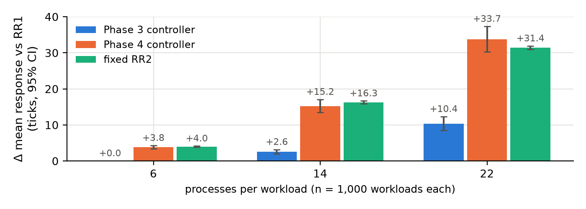

# Machine-Learning-Assisted Adaptive CPU Scheduling

*Predicting workload behavior. Optimizing scheduling decisions.*

**Ujval Sai** (individual project) · [Course name and code] · [Instructor] · [University] · [Submission date]

Repository: https://github.com/ujvall/schedX · Reproducibility reference: commit `e848cf2` (https://github.com/ujvall/schedX/commit/e848cf2)

> **Draft status (remove before submission):** this text was drafted with an AI assistant from the project's committed evidence. Under a course rule limiting AI-generated content, it must be rewritten in the author's own words and checked against the institution's AI-use policy before it is submitted. See the disclosure in Section 9.

## Abstract

Round Robin (RR) scheduling needs a time quantum. Small quanta give quick first responses and help short jobs; large quanta reduce context switching and suit workloads of similar-length jobs. This case study asks whether predicting workload behaviour can choose the quantum better than a fixed setting. SchedX is a reproducible discrete-event CPU scheduling simulator with five classical algorithms, a synthetic workload generator, and machine-learning (ML) controllers that select an RR quantum per workload from information available at decision time. Controllers were selected on validation data and frozen before testing. The principal experiment evaluated them on three independently generated operating points of 6, 14, and 22 processes per workload, with 1,000 workloads each. The frozen controller reduced per-workload mean turnaround compared with the best fixed quantum (RR1) at every operating point, by 0.06%, 0.30%, and 0.49% (geometric means). These reductions are statistically supported after Holm correction, but all lie below the pre-declared 1% practical threshold, and the controller increases mean response time. A censoring-aware estimator improved online estimates but not decisions. All results come from a CPU-only simulator with synthetic workloads; no kernel or hardware experiment was performed.

**Keywords:** CPU scheduling, Round Robin, time quantum, machine learning, simulation, Kaplan–Meier, paired statistical testing

## 1. Problem statement and objectives

Operating systems commonly use time-sliced scheduling. The quantum length is a compromise: very small quanta approach equal sharing of the CPU but cause many context switches, while very large quanta make RR behave like first-come, first-served (FCFS) [1]. No single fixed quantum is best for every workload. This raises the question of whether a scheduler that *predicts* workload behaviour can make a better choice.

**Research question.** Can process-behaviour prediction improve scheduling-policy or time-quantum decisions compared with fixed, rule-based CPU scheduling?

**Objectives.**

1. Build a reproducible simulator with classical algorithms and shared metric definitions.
2. Generate labelled synthetic workloads, and test whether workload behaviour can be predicted from information a scheduler would actually have.
3. Use those predictions to choose an RR quantum, and compare the result fairly with fixed quanta.
4. Validate the frozen controllers at three independent workload sizes.

## 2. Background and related work

Shortest Remaining Time First (SRTF) minimises mean turnaround on a single processor when job lengths are known [3]. A real scheduler does not know future CPU burst lengths, which is why practical schedulers fall back on non-clairvoyant policies such as RR. Queueing analyses of time-shared systems have long studied how quantum size affects delay [2], and textbooks describe the same trade-off between response time and switching overhead [1]. Machine-learning techniques have also been applied to process scheduling, for example in work on Linux process scheduling [12]. This project does not propose a new scheduling algorithm. Its contribution is a controlled, leakage-safe evaluation of whether learned quantum selection helps, including a negative result.

## 3. SchedX design

### 3.1 Simulator and algorithms

The simulator is a deterministic discrete-event model of one CPU with integer time ticks. It implements FCFS, non-preemptive Shortest Job First (SJF), SRTF, RR, and Priority scheduling (non-preemptive and preemptive), with documented tie-breaking. An adaptive RR variant allows the quantum to change during a run. A slice that has already started keeps its quantum, and with a constant quantum it reproduces ordinary RR exactly (tested). Context switches are counted but cost zero time.

**Metrics.** For each job:

* turnaround = completion − release;
* waiting = turnaround − CPU time;
* response = first dispatch − release.

Throughput and CPU utilization are measured over the interval from the first arrival to the last completion. A context switch is counted when a different job is dispatched.

### 3.2 From workloads to jobs

Each generated process alternates CPU bursts and I/O waits. For scheduling, every CPU burst becomes one job, released at the time it would start if there were no contention (the *burst-trace projection*). I/O is recorded but not simulated as blocking, so this is a CPU-only, open-loop model.

### 3.3 Prediction and control

* **Workload classifiers.** Logistic Regression, Decision Tree, and Random Forest models (scikit-learn [4]; Random Forest [5]) predict whether a workload is CPU-bound, I/O-bound, or mixed.
* **Quantum controller.** The scheduler starts with RR1, the best fixed quantum on training and validation data. After a fixed number of job completions, it builds features from the schedule that has actually run, decides once whether to keep RR1 or switch to another quantum in {2, 4, 8}, and continues. If no decision point is reached, it keeps RR1. A whitelist blocks any feature not available at decision time.
* **Censoring-aware estimator.** Under RR1 the short jobs finish first, so completed bursts are a biased sample. The estimator treats each unfinished job as *right-censored*: its burst is known to exceed the CPU time it has received so far. It uses the Kaplan–Meier estimator [6] and reports, instead of extrapolating, the probability mass it cannot identify.

## 4. Data and methodology

### 4.1 Workloads and labels

A seeded generator creates each workload independently from the pair (master seed, index):

* process counts of 4–24;
* exponential inter-arrival gaps;
* CPU-heavy or I/O-heavy processes;
* Gamma-distributed integer bursts with workload-specific variability.

Labels are computed from the realized traces, not from the generator's intent. A process is I/O-bound if more than half its time is I/O. A workload is CPU-bound if at most 25% of its processes are I/O-bound, I/O-bound if at least 75% are, and mixed otherwise. The development dataset has 1,500 workloads (21,453 processes; 484 CPU-bound, 527 I/O-bound, 489 mixed), split by workload into 900 training, 300 validation, and 300 test workloads, stratified by class.

### 4.2 Information available to the scheduler

**Table 1.** Feature availability categories.

| Category | Content | Used by controller |
|---|---|---|
| A: submission | process count, arrival times, priorities | yes |
| O: online observation | released jobs, CPU received so far, completed burst lengths, switches | yes |
| E: censoring-aware | Kaplan–Meier estimates of unfinished bursts | yes (estimator variant) |
| B: first *k* bursts (Phase 2) | optimistic: includes processes that have not arrived yet | classifiers only |
| C: retrospective | lifetime totals, labels | never |

### 4.3 Evaluation protocol

All learning used training data, all selection used validation data, and each controller was committed in Git before any test evaluation. Every comparison is *paired*: each method schedules the identical job list of a workload, and the principal experiment records a hash of each method's input to prove it. The primary outcome is each workload's mean job turnaround, `T`.

Two summaries are reported:

* **Geometric-mean change** (the pre-specified estimand): the geometric mean over workloads of `T_method / T_baseline`, minus 1. Each workload counts equally, whatever its size.
* **Aggregate change:** the change in mean turnaround across all workloads, which weights long-running workloads more.

Tests are two-sided paired sign-flip permutation tests of the mean log ratio [8]. Confidence intervals are paired percentile bootstrap intervals with 10,000 resamples [7]. Holm's procedure [9] corrects for multiple comparisons within pre-specified families. A result counts as **practically meaningful** only if the whole 95% CI lies below −1%, a smallest effect of interest set before the experiment at about one third of the oracle headroom (Section 5.2).

### 4.4 Principal experiment: three operating points

Three new workload sets were generated with the same generator rules. Only the number of processes per workload changes. All three sizes lie inside the controllers' training range, so nothing is extrapolated.

**Table 2.** Principal-experiment operating points.

| Operating point | Processes per workload | Workloads | Master seed | Total jobs |
|---|---|---|---|---|
| Small | 6 | 1,000 | 5101 | 32,326 |
| Medium | 14 | 1,000 | 5102 | 77,567 |
| Large | 22 | 1,000 | 5103 | 121,900 |

None of the 3,000 workloads matches any of the 2,100 workloads used earlier, compared by hashes of their full input traces.

## 5. Results

### 5.1 Development results

**Classification (Phase 2).** On the 300 test workloads, Logistic Regression (chosen by validation score) reached 87.6% accuracy (macro-F1 0.874), the Decision Tree 86.4%, and the Random Forest 89.2%. Mapping the predicted class to a policy did not reliably beat a fixed RR2: every 95% CI of the regret difference included zero.

**Quantum controller (Phase 3).** On the 300 test workloads the controller changed turnaround by −0.38% (95% CI −0.75% to −0.04%) compared with RR1. The pre-specified Wilcoxon signed-rank test with Pratt's zero handling [10, 11] gave p = 0.50. A later audit showed that the two procedures target different quantities: the bootstrap describes the *mean* log ratio, while the rank test, with 275 of 300 pairs tied, behaves almost like a sign test. The result was therefore treated as inconclusive.

**Estimator (Phase 4).** On training data, the Kaplan–Meier estimator cut the error of the estimated restricted mean burst from 0.43–0.50 to 0.08–0.10 (mean absolute log error). Decisions did not improve. Against the Phase 3 controller, the estimator-based controller changed turnaround by +0.64% (95% CI +0.02% to +1.28%, Holm p = 0.14) on the established test split and by +0.08% (95% CI −0.35% to +0.51%) on 600 fresh workloads.

### 5.2 Principal experiment

**Table 3.** Change in turnaround compared with RR1 (negative = faster; 95% CIs in brackets; Holm correction over six primary hypotheses).

| Size | Controller | Geometric-mean change | Aggregate change | Holm p | Classification |
|---|---|---|---|---|---|
| 6 | Phase 3 | −0.06% [−0.10, −0.02] | −0.01% | 0.026 | supported, below 1% |
| 14 | Phase 3 | −0.30% [−0.53, −0.08] | −0.12% | 0.038 | supported, below 1% |
| 22 | Phase 3 | −0.49% [−0.72, −0.26] | −0.28% | 0.0003 | supported, below 1% |
| 6 | Phase 4 | +0.13% [−0.19, +0.45] | −0.04% | 1.00 | negligible |
| 14 | Phase 4 | −0.04% [−0.38, +0.30] | +0.12% | 1.00 | negligible |
| 22 | Phase 4 | −0.10% [−0.45, +0.24] | −0.02% | 1.00 | negligible |


The Phase 3 controller improved on RR1 at every size, and the benefit grew with the number of processes. At 22 processes the aggregate change of −0.28% corresponds to mean turnaround falling from 305.70 to 304.85 ticks. The controller changed the quantum on only 3.2%, 7.7%, and 10.3% of workloads. At 6 processes, 13.2% of workloads ended before the decision point and kept RR1. A per-workload *oracle* that knows every fixed quantum's outcome would gain 3.25%, 2.73%, and 2.40%, so most of the available improvement is not captured. The Phase 4 controller switched far more often (29–42% of workloads) without a measurable turnaround benefit.

### 5.3 Secondary outcomes



* **Response time.** The Phase 3 controller increased mean response time compared with RR1 by +0.03 ticks (6 processes), +2.57 ticks [1.98, 3.19] (14), and +10.36 ticks [8.42, 12.32] (22). Switching to a larger quantum delays the first dispatch of waiting jobs. The Phase 4 controller's increases (+3.8, +15.2, +33.7 ticks) were similar to those of a fixed RR2.
* **Context switches.** The Phase 3 controller reduced them slightly (for example, from 891.1 to 848.1 per workload at 22 processes).
* **Throughput and CPU utilization.** These were identical for every method within each operating point (for example, 0.150 jobs per tick and 98.7% utilization at 22 processes). This is expected: every policy is work-conserving and receives the same jobs.

## 6. Discussion

**Statistical versus practical significance.** With 1,000 paired workloads per size, the experiment can detect very small effects. The Phase 3 benefit is real in the statistical sense, consistent across sizes, and replicated on new data, but it is under half a percent. Pooled with equal weight across the three sizes it is −0.28% (95% CI −0.39% to −0.17%). The cost in response time is larger in relative terms. A practitioner could reasonably prefer a fixed RR1.

**Why the gains are small.** On training data the true variability of job lengths was strongly related to whether a large quantum beats RR1 (Spearman 0.79), but the variability *observed* at decision time was only moderately related (0.46). A small default quantum hides long jobs until late in the run, so the controller sees mostly short bursts and switches rarely. The censoring-aware estimator corrected the bias in the part of the distribution it can see. It could not recover the unseen long tail, and it led to more frequent switches that won and lost about equally.

**Why the negative result matters.** A weak signal is easy to overstate, for example by using features that would not exist at decision time (category B) or by tuning on test data. The study's controls (frozen controllers, paired inputs, pre-specified statistics, independent operating points) guard against both, so its conclusion is defensible: within this simulator, learned quantum selection gives at most a small turnaround gain and costs response time.

## 7. Limitations and threats to validity

1. **Synthetic workloads** from a single generator family; no real process traces.
2. **Simulator only.** The model is CPU-only and open-loop: I/O does not block and contention does not delay later bursts. Context switches cost nothing, so RR1's many switches are free here but would not be on real hardware. **No kernel-level or hardware measurement was performed.**
3. **One decision per workload**, and the default quantum limits what can be observed.
4. **The 1% threshold** is a pre-declared judgement; other thresholds would change the "practical" label, though not the estimates.
5. **Test reuse.** The Phase 3 test split was reused in Phase 4. Fresh workloads (Phase 4) and the independent operating points (Phase 5) address this.
6. **Reproduction was verified on one environment** (Windows, Python 3.11.9); other platforms and library versions are untested.

## 8. Conclusion

SchedX shows that ML-assisted quantum selection can be evaluated rigorously, and that in this simulated setting its benefit is small. The frozen controller improved mean turnaround over the best fixed quantum by 0.06–0.49% across three workload sizes. The improvement is statistically supported but below the 1% practical threshold, and it is paid for in response time. A better estimator of unfinished work did not translate into better decisions. Future work should model context-switch cost and I/O blocking, allow repeated decisions during a run, and select controllers using a criterion that also accounts for response time.

## 9. Individual contribution and AI-assistance disclosure

**Contribution.** This is an individual project by Ujval Sai (GitHub `ujvall`). The repository has a single Git author (`cremebits`, the author's Git identity), and the student directed every project phase.

**AI assistance (draft for the student to review against the course policy).** The SchedX code, tests, analysis scripts, and documentation were developed with substantial assistance from an AI coding assistant (Claude), working under the student's direction in an interactive development environment. This report draft was also prepared with that assistance from the committed evidence. All reported numbers come from the committed result files; none were produced by hand. [Add here the specific review and work the student personally performed, and any form of disclosure the course requires.]

## 10. Reproducibility

Code, configurations, seed manifests, and raw per-workload CSVs are in the repository: `src/schedx/`, `configs/`, `scripts/`, and `reports/phase2`–`phase5/`. Phase 5's raw inputs are in `reports/phase5/inputs/` and its per-workload outcomes in `reports/phase5/raw_workload_results.csv`. With Python 3.11, from a fresh clone:

```
pip install -e ".[dev]"
python scripts/generate_dataset.py
python scripts/train_evaluate.py
python scripts/phase3_train.py
python scripts/phase4_train.py
python scripts/phase5_run.py
python scripts/phase5_audit.py
python -m pytest -q
```

The Phase 6 audit regenerated all Phase 3–5 evidence identically from a fresh clone; Phase 2 matched apart from wall-clock timing fields.

## References

[1] A. Silberschatz, P. B. Galvin, and G. Gagne, *Operating System Concepts*. Wiley, 2018. ISBN 978-1-119-32091-3.

[2] L. Kleinrock, "Time-shared systems," *Journal of the ACM*, vol. 14, no. 2, pp. 242–261, 1967. doi:10.1145/321386.321388.

[3] L. Schrage, "A proof of the optimality of the shortest remaining processing time discipline," *Operations Research*, vol. 16, no. 3, pp. 687–690, 1968. doi:10.1287/opre.16.3.687.

[4] F. Pedregosa et al., "Scikit-learn: Machine learning in Python," *Journal of Machine Learning Research*, vol. 12, pp. 2825–2830, 2011.

[5] L. Breiman, "Random forests," *Machine Learning*, vol. 45, no. 1, pp. 5–32, 2001. doi:10.1023/A:1010933404324.

[6] E. L. Kaplan and P. Meier, "Nonparametric estimation from incomplete observations," *Journal of the American Statistical Association*, vol. 53, no. 282, pp. 457–481, 1958. doi:10.1080/01621459.1958.10501452.

[7] B. Efron, "Bootstrap methods: Another look at the jackknife," *The Annals of Statistics*, vol. 7, no. 1, pp. 1–26, 1979. doi:10.1214/aos/1176344552.

[8] P. Good, *Permutation, Parametric and Bootstrap Tests of Hypotheses*. Springer, 2005. doi:10.1007/b138696.

[9] S. Holm, "A simple sequentially rejective multiple test procedure," *Scandinavian Journal of Statistics*, vol. 6, pp. 65–70, 1979. https://www.jstor.org/stable/4615733.

[10] F. Wilcoxon, "Individual comparisons by ranking methods," *Biometrics Bulletin*, vol. 1, no. 6, pp. 80–83, 1945. doi:10.2307/3001968.

[11] J. W. Pratt, "Remarks on zeros and ties in the Wilcoxon signed rank procedures," *Journal of the American Statistical Association*, vol. 54, no. 287, pp. 655–667, 1959. doi:10.1080/01621459.1959.10501526.

[12] A. Negi and P. Kumar, "Applying machine learning techniques to improve Linux process scheduling," in *TENCON 2005 – IEEE Region 10 Conference*, 2005, pp. 1–6. doi:10.1109/TENCON.2005.300837.
